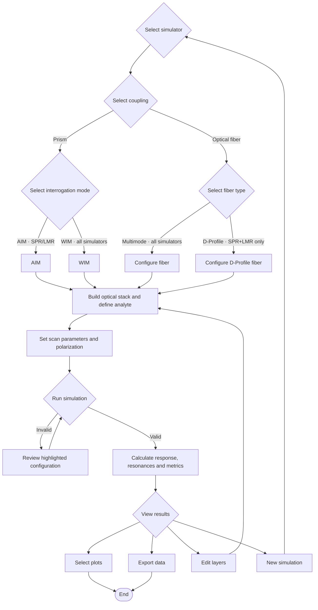

# Sim-SPR / Sim-LMR / Sim-SPR+LMR

Sim-SPR / Sim-LMR / Sim-SPR+LMR is a free and open-source simulator for multilayer optical sensors based on Surface Plasmon Resonance (SPR), Lossy Mode Resonance (LMR), and combined SPR+LMR effects.

The simulator is implemented in Python and provides a graphical user interface developed with PyQt5.

## Repository

- `Sim-SPR-LMR-1.0/`: version 1.0.
- `Sim-SPR-LMR-2.0/`: version 2.0.

The features and instructions below refer to version 2.0.

## Overview

This simulator computes the optical response of multilayer sensing structures for refractive-index sensing studies. The user builds an optical stack, defines an analyte refractive-index sweep, chooses an interrogation mode, and runs a numerical simulation that produces reflectance or normalized transmission curves plus derived resonance metrics.

The implemented simulator families are:

- `SPR`: prism- or multimode-fiber-coupled multilayer simulation using the transfer-matrix method.
- `LMR`: prism- or multimode-fiber-coupled simulation using the same multilayer optical engine, with resonance behavior defined by the chosen lossy coatings.
- `SPR+LMR`: combined lossy-mode and plasmonic simulation with prism or optical-fiber coupling and wavelength interrogation.

## Features

### Simulation Modes

- SPR simulation.
- LMR simulation.
- Combined `SPR+LMR` simulation.
- Prism coupling for `SPR`, `LMR`, and `SPR+LMR`.
- Multimode optical-fiber coupling for `SPR`, `LMR`, and `SPR+LMR`.
- AIM for prism-coupled `SPR` and `LMR`.
- WIM for prism-coupled `SPR` and `LMR`.
- WIM-only execution for `SPR+LMR`.
- TE, TM, and unpolarized `TE+TM` execution for the current implementation.

### Obtained Parameters

The simulator provides the following output parameters from the simulated or imported resonance curves:

- **Resonance curve**: optical response of the sensor as a function of incidence angle or wavelength.
- **Resonance angle or resonance wavelength**: position of a resonance dip. In AIM, this parameter is reported as an angle in degrees. In WIM, it is reported as a wavelength in nanometers. For `SPR+LMR`, multiple significant dips may be detected.
- **Minimum reflectance or minimum transmission**: lowest response value at the resonance dip.
- **Sensitivity**: resonance shift divided by the analyte refractive-index variation, expressed as `deg/RIU` for AIM or `nm/RIU` for WIM.
- **FWHM (Full Width at Half Maximum)**: width of the resonance dip measured at half of its local depth.
- **QF (Quality of Factor)**: ratio between sensitivity and FWHM.
- **Critical angle**: shown for AIM reflectance simulations when available, indicating the approximate total internal reflection threshold associated with the analyte/substrate interface.

### Results, Graphs, and Exports

- Reflectance curve plotting.
- Normalized transmission plotting for fiber-coupled `SPR`, `LMR`, and `SPR+LMR` simulations.
- Reflectance-in-dB plotting for prism-coupled `SPR+LMR`.
- Response curves for multiple analyte refractive indices.
- Resonance point versus analyte plot.
- Sensitivity versus analyte plot.
- FWHM versus analyte plot.
- Figure of merit versus analyte plot.
- Textual simulation summary in the GUI.
- Export of response curves and parameter summaries to text files.


## User Flowchart



## External Libraries

External Python libraries:

- `PyQt5`
- `qtrangeslider`
- `numpy`
- `scipy`
- `matplotlib`
- `pandas`
- `tabulate`
- `openpyxl`


## Installation

### Requirements

- Python 3.10 or newer.
- A desktop environment capable of running PyQt5 windows.
- The Python packages listed below.

### Install Dependencies

From the repository root:

```bash
python -m pip install --upgrade pip
python -m pip install -r requirements.txt
```

### Run the Application

From the repository root, enter the version 2.0 application folder:

```bash
cd Sim-SPR-LMR-2.0/sim-spr-lmr-simulator
python main.py
```

On Windows PowerShell:

```powershell
Set-Location .\Sim-SPR-LMR-2.0\sim-spr-lmr-simulator
python .\main.py
```
