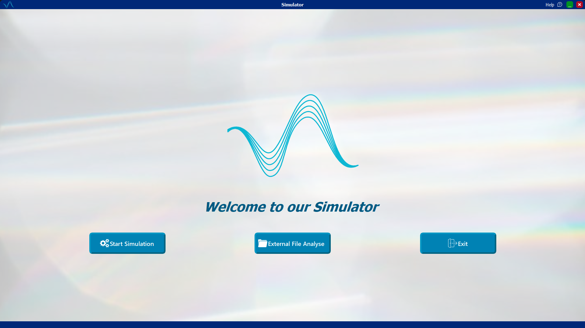
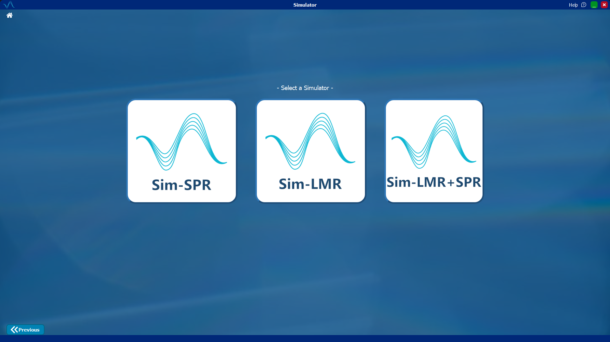
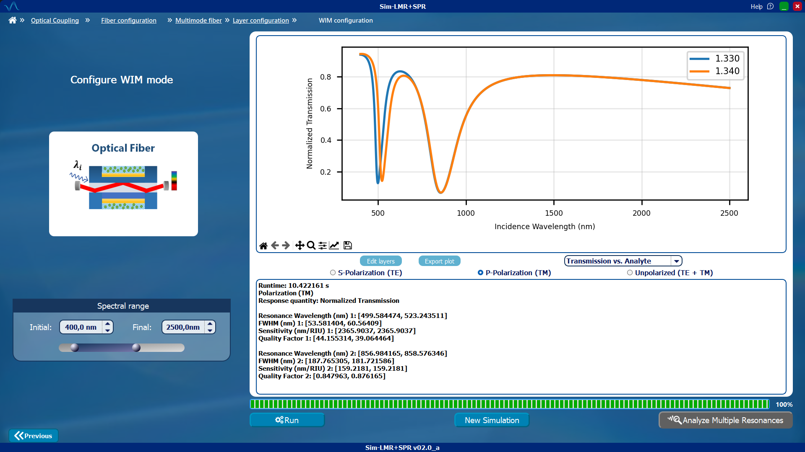
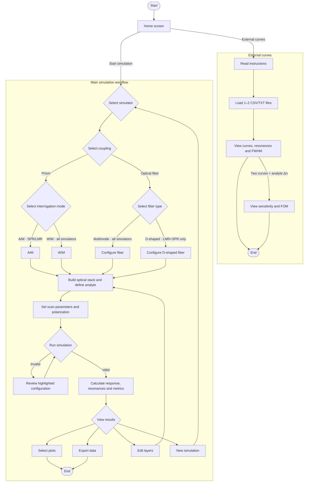

# Sim-SPR / Sim-LMR / Sim-LMR+SPR

Sim-SPR / Sim-LMR / Sim-LMR+SPR is a free and open-source simulator for multilayer optical sensors based on Surface Plasmon Resonance (SPR), Lossy Mode Resonance (LMR), and combined LMR+SPR effects.

The simulator is implemented in Python and provides a graphical user interface developed with PyQt5.

<table align="center">
    <tr>
        <td>
            
        </td>
        <td>
            
        </td>
        <td>
            
        </td>
    </tr>
</table>

<div align="center">

<p>
  <a href="https://www.python.org/">
    
  </a>
  <a href="https://www.riverbankcomputing.com/software/pyqt/">
    
  </a>
  
  
  
</p>

<p>
  <a href="https://github.com/helderufcg/Sim-SPR-LMR/releases/tag/1.0">
    
  </a>
  <a href="https://github.com/helderufcg/Sim-SPR-LMR/releases/tag/v2.0">
    
  </a>
</p>

</div>

---

## Overview

This simulator computes the optical response of multilayer sensing structures for refractive-index sensing studies. The user builds an optical stack, defines an analyte refractive-index sweep, chooses an interrogation mode, and runs a numerical simulation that produces reflectance or normalized transmission curves plus derived resonance metrics.

The implemented simulator families are:

- `SPR`: prism- or multimode-fiber-coupled multilayer simulation using the transfer-matrix method.
- `LMR`: prism- or multimode-fiber-coupled simulation using the same multilayer optical engine, with resonance behavior defined by the chosen lossy coatings.
- `LMR+SPR`: combined lossy-mode and plasmonic simulation with prism or optical-fiber coupling and wavelength interrogation.

## Features

### Simulation Modes

- SPR simulation.
- LMR simulation.
- Combined `LMR+SPR` simulation.
- Prism coupling for `SPR`, `LMR`, and `LMR+SPR`.
- Multimode optical-fiber coupling for `SPR`, `LMR`, and `LMR+SPR`.
- AIM for prism-coupled `SPR` and `LMR`.
- WIM for prism-coupled `SPR` and `LMR`.
- WIM-only execution for `LMR+SPR`.
- TE, TM, and unpolarized `TE+TM` execution for the current implementation.

### Optical Stack Editing

- Add, edit, and remove multilayer stack entries.
- Add one analyte layer.
- Generate an analyte refractive-index sweep from initial index, sample count, and step.
- Layer material, thickness, refractive index display value, description, dispersion model, and optional Drude parameters.
- Save, load, and delete layer presets.
- Export the layer table as LaTeX, Excel, CSV, or plain text.

### Obtained Parameters

The simulator provides the following output parameters from the simulated or imported resonance curves:

- **Resonance curve**: optical response of the sensor as a function of incidence angle or wavelength.
- **Resonance angle or resonance wavelength**: position of a resonance dip. In AIM, this parameter is reported as an angle in degrees. In WIM, it is reported as a wavelength in nanometers. For `LMR+SPR`, multiple significant dips may be detected.
- **Minimum reflectance or minimum transmission**: lowest response value at the resonance dip.
- **Sensitivity**: resonance shift divided by the analyte refractive-index variation, expressed as `deg/RIU` for AIM or `nm/RIU` for WIM.
- **FWHM (Full Width at Half Maximum)**: width of the resonance dip measured at half of its local depth.
- **FOM (Figure of merit)**: ratio between sensitivity and FWHM.
- **Critical angle**: shown for AIM reflectance simulations when available, indicating the approximate total internal reflection threshold associated with the analyte/substrate interface.

### Results, Graphs, and Exports

- Reflectance curve plotting.
- Normalized transmission plotting for fiber-coupled `SPR`, `LMR`, and `LMR+SPR` simulations.
- Reflectance-in-dB plotting for prism-coupled `LMR+SPR`.
- Response curves for multiple analyte refractive indices.
- Resonance point versus analyte plot.
- Sensitivity versus analyte plot.
- FWHM versus analyte plot.
- Figure of merit versus analyte plot.
- Textual simulation summary in the GUI.
- Export of response curves and parameter summaries to text files.


## Repository

```text
Sim-SPR-LMR/                         # Simplified repository structure
├── README.md
├── requirements.txt
├── resources/
│   └── icons.qrc                   # Source manifest for Qt resources
├── sim-spr-lmr-simulator/          # Executable desktop application
│   ├── main.py                     # Entry point and Qt application composition
│   ├── Sim_LMR_interface.py        # Authoritative frozen main-window UI
│   ├── instructions.py             # Generated UI for instructions dialog
│   ├── open_extern_file.py         # Generated UI for external-curve analysis
│   ├── save_files.py               # Generated UI for result export
│   ├── save_table.py               # Generated UI for layer-table export
│   ├── icons.py / icons_.py        # Compiled and compatibility Qt resources
│   ├── layer_presets.json          # Layer preset catalog
│   ├── icons/                      # Runtime images and icons
│   └── sim_spr_lmr/
│       ├── application/            # Use cases, validation and input mapping
│       ├── core/
│       │   ├── domain/             # Simulation and result models
│       │   ├── materials/          # Material catalog and dispersion models
│       │   └── optics/             # Optical engine and post-processing
│       ├── infrastructure/
│       │   └── exporters/          # Simulation and analysis exporters
│       └── presentation/
│           ├── plotting/           # Graph rendering and result summaries
│           └── qt/                 # Controllers, dialogs, presenters and state
├── ui/
│   ├── README_ui.md                # UI maintenance and regeneration guidance
│   ├── Instructions.ui             # Maintained secondary-dialog sources
│   ├── open_extern_file.ui
│   ├── save_files.ui
│   ├── save_table.ui
│   ├── main_interface_stable_legacy.ui
│   │                               # Visual reference; not authoritative
│   └── legacy-v1.0/                # Historical Qt Designer files
├── tests/
│   ├── core/                       # Optical-core unit tests
│   └── previews/                   # Manual UI preview utilities
├── tools/                          # UI/resource build and validation scripts
└── Sim-SPR-LMR-1.0/                # Preserved version-1.0 snapshot
```

## User Flowchart



## External Libraries

External Python libraries:

- `PyQt5`
- `qtrangeslider` (optional; the application falls back to two Qt spin boxes when it is unavailable)
- `numpy`
- `scipy`
- `matplotlib`
- `pandas`
- `tabulate`
- `openpyxl`

The `qtrangeslider` package provides the full range-slider widget experience. It is included in `requirements.txt`, but the application can still run without it by using the built-in compatibility proxy.


## Installation

### Requirements

- Python 3.10 or newer.
- A desktop environment capable of running PyQt5 windows.
- The Python packages listed below.

The code uses Python 3.10+ syntax, including structural pattern matching, `dataclass(slots=True)`, and modern type-union syntax.

### Install Dependencies

From the repository root:

```bash
python -m pip install --upgrade pip
python -m pip install -r requirements.txt
```

### Run the Application

From the executable application folder:

```bash
cd sim-spr-lmr-simulator
python main.py
```

On Windows PowerShell:

```powershell
Set-Location .\sim-spr-lmr-simulator
python .\main.py
```

### Run Automated Tests

The automated suite uses `pytest`, which is a development dependency and is not required to run the desktop application. From the repository root:

```bash
python -m pip install pytest
python -m pytest
```

## Authors and Contact

**Ricardo Ferreira do Santos Silva**  
Electrical Engineering Department,
Federal University of Campina Grande (UFCG), Brazil  
E-mail: `ricardo.silva@ee.ufcg.edu.br`  
GitHub: [@ricardofss1](https://github.com/ricardofss1)


**Isa Cristina Gonçalves de Paiva**  
Electrical Engineering Department,
Federal University of Campina Grande (UFCG), Brazil  
E-mail: `isa.paiva@ee.ufcg.edu.br`  
GitHub: [@isacristinagp](https://github.com/isacristinagp)

**Helder Alves Pereira**  
Electrical Engineering Department,
Federal University of Campina Grande (UFCG), Brazil  
E-mail: `helder.pereira@dee.ufcg.edu.br.`  
GitHub: [@helderufcg](https://github.com/helderufcg)

